# Отчёт по лабораторной работе №1
## «Управление многоконтейнерными системами»

**Дисциплина:** Непрерывное интегрирование и сборка программного обеспечения  
**Студент:** Бельский Тимофей Дмитриевич  
**Группа:** 11а  
**Год:** 2026  
**GitHub:** [pipa53](https://github.com/pipa53)  
**Docker Hub:** [timofeos/mynginx-lab1](https://hub.docker.com/r/timofeos/mynginx-lab1)

---

## Введение

Цель работы — освоить жизненный цикл контейнеров Docker: от запуска готовых образов и bind mount до собственной сборки, оптимизации слоёв, оркестрации Compose, миграций БД и локального LLM-контура.

Задачи работы (по методическим указаниям):

1. Установить Docker Desktop, проверить Engine (`docker version`, `docker info`).
2. Запустить несколько контейнеров nginx с пробросом портов, выполнить команды внутри контейнера, остановить и удалить контейнер.
3. Подключить bind mount и убедиться, что правки HTML видны без пересборки образа.
4. Собрать свой образ по Dockerfile, проанализировать слои (`history` / `inspect`), опубликовать образ в Docker Hub.
5. Написать FastAPI-приложение, подключить PostgreSQL в Docker, собрать образ и последовательно оптимизировать его (v1→v6).
6. Описать стек из нескольких контейнеров через Docker Compose (nginx + приложение + БД), healthcheck и сети.
7. Развернуть инфраструктуру варианта 1 «Учёт читателей библиотеки»: Liquibase, CRUD, отчёт, Swagger.
8. Поднять локальную LLM (Ollama + LiteLLM + Open WebUI), подключить Claude Code CLI.
9. Вынести инфраструктуру на хост (dev/prod) и автоматизировать стенд Makefile.

Используемые средства:

| Средство | Версия / заметка |
| --- | --- |
| Docker Desktop | Engine **29.8.0**, API 1.55 |
| Docker Compose | v5.5.1 (плагин CLI, не бинарь `docker-compose`) |
| Buildx | v0.37.0-desktop.1 |
| WSL2 | ядро 6.18.33.2-microsoft-standard-WSL2 |
| ОС хоста | Windows 11, 16 CPU, 7.6 GiB RAM в VM Docker |
| GPU | NVIDIA GeForce RTX 4070 Laptop, 8188 MiB |
| Python (локально) | 3.13.15 в venv (для task3), 3.12.1 в Docker-образах |
| Node.js | 22 (образ Claude Code CLI, task6) |
| PostgreSQL | 16.2-alpine |
| Redis | 7.2-alpine |
| GNU Make | цели в `task6/Makefile` |

Структура каталога `C:\Lab1`: `task1/` … `task6/`, общий отчёт — этот файл, скриншоты — `docs/screenshots/`.

---

## Задание 1. Основы управления контейнерами и образами Docker

### Что требовалось

Научиться запускать контейнеры из готовых образов Docker Hub, публиковать порты на хост, выполнять команды внутри контейнера (`docker exec`), корректно останавливать и удалять контейнеры, отличить интерактивный режим от фонового, подключить bind mount и проверить «горячую» замену файлов без `docker build`.

### Что сделано

Запущены три независимых контейнера nginx на разных тегах и портах:

| Имя | Образ | Порт хоста → 80 |
| --- | --- | --- |
| `mynginxlast` | `nginx:latest` | 8080 |
| `mynginxalpine` | `nginx:alpine` | 8081 |
| `mynginx1-28` | `nginx:1.28` | 8082 |

Команды (PowerShell, Docker Desktop Linux-engine):

```powershell
docker run --name mynginxlast   -p 8080:80 -d nginx:latest
docker run --name mynginxalpine -p 8081:80 -d nginx:alpine
docker run --name mynginx1-28   -p 8082:80 -d nginx:1.28
docker ps
```

Синтаксис `-p host:container` публикует порт контейнера на интерфейсе хоста. Без `-p` nginx слушает 80 только внутри сетевого namespace контейнера. Флаг `-d` (detached) отвязывает процесс от терминала; контейнер остаётся в статусе Up.

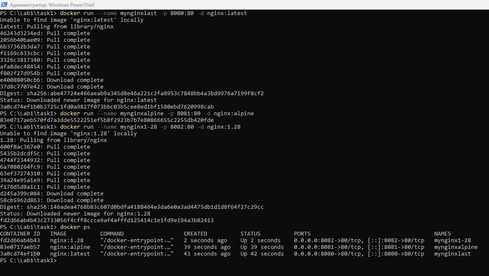

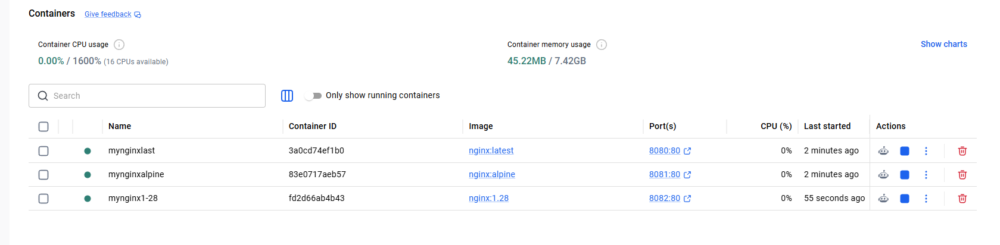

Проверка с хоста:

```powershell
curl.exe http://localhost:8080
curl.exe http://localhost:8081
curl.exe http://localhost:8082
```

Все три ответа — HTML «Welcome to nginx!»: образы различаются тегом (latest / alpine / 1.28), но отдают одинаковую штатную страницу.

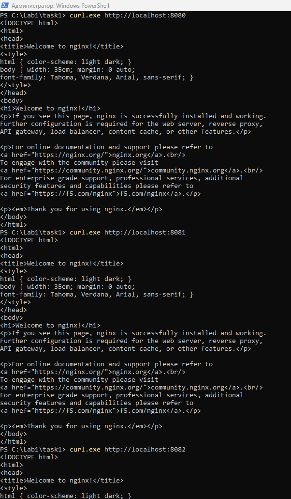

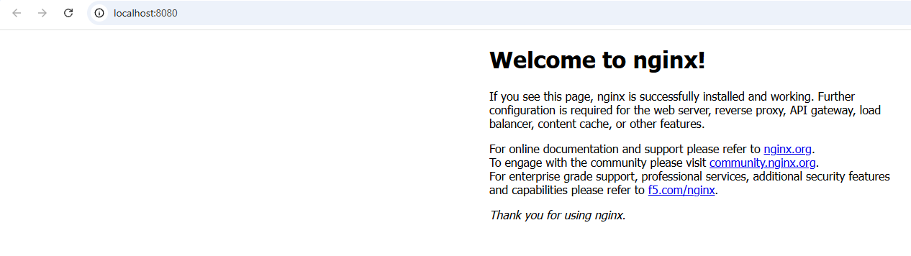

### Команды внутри контейнера

```powershell
docker exec -it mynginxlast sh
# внутри: pwd, ls /usr/share/nginx/html, cat /usr/share/nginx/html/index.html, hostname, exit
```

`docker exec` стартует **новый** процесс в уже работающем контейнере. `-i` держит stdin, `-t` выделяет TTY. Оболочка `sh` есть и в debian-based `nginx:latest`, и в alpine. `hostname` внутри совпадает с ID контейнера. После `exit` контейнер **продолжает работать**: завершился только exec-процесс, PID 1 (nginx) жив.

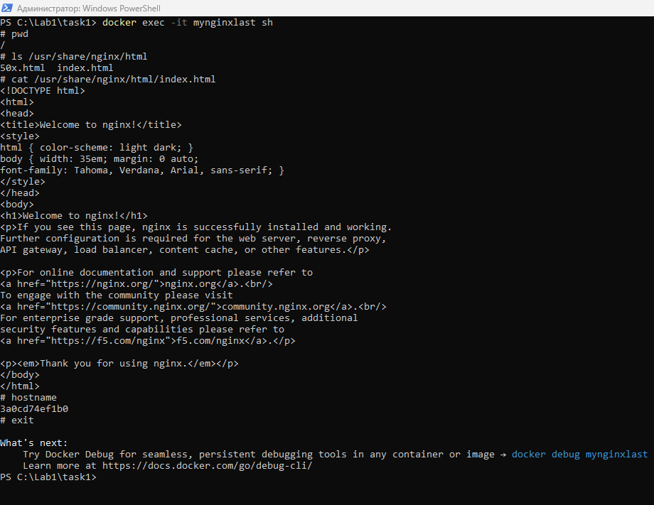

### Остановка и удаление

```powershell
docker stop mynginxlast
docker rm mynginxlast
docker ps -a
```

`stop` посылает SIGTERM PID 1, ждёт timeout (по умолчанию 10 с), затем SIGKILL. `rm` удаляет контейнер (writable layer), образ `nginx:latest` остаётся.

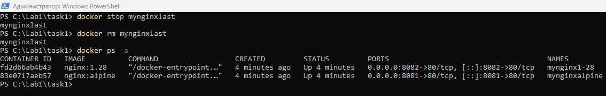

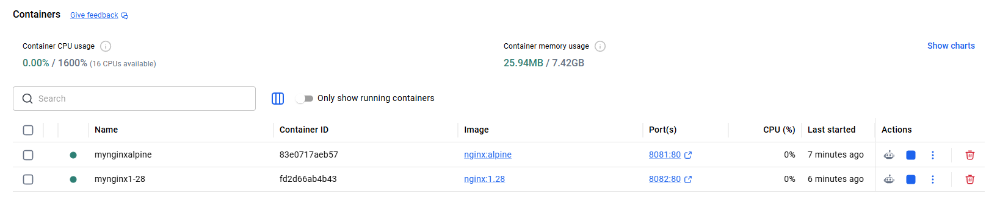

### Интерактивный запуск без `-d`

```powershell
docker run --name mynginxlast -p 8080:80 -it nginx:latest sh
# внутри: ls /, exit
```

Если запустить контейнер без `-d`, но с `-it`, терминал привязан к нему. Основной процесс — оболочка `sh`. После `exit` оболочка завершается, а вместе с ней — контейнер (`Exited (0)`).

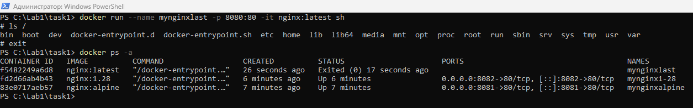

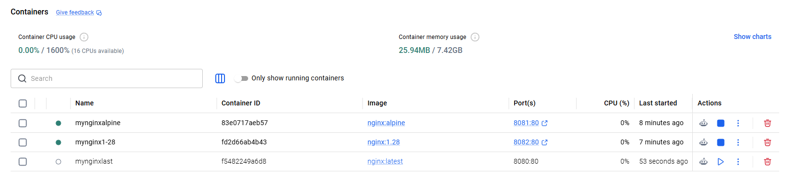

### Bind mount своей HTML-страницы

Файл `task1/index.html` — страница студента (ФИО, группа, пояснение про том). Она **не** копируется в образ, а монтируется поверх `/usr/share/nginx/html`.

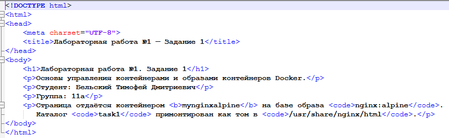

Запуск alpine-контейнера с томом:

```powershell
docker run --name mynginxalpine -p 8081:80 -d `
  -v "C:\Lab1\task1:/usr/share/nginx/html" nginx:alpine
curl.exe http://localhost:8081
```

`-v host:container` — bind mount. Каталог `task1` на Windows проецируется в Linux-путь контейнера через Docker Desktop file sharing. Nginx отдаёт `index.html` с хоста.

> На Windows путь лучше указывать **абсолютный** (`C:\Lab1\task1`) — переменная `${PWD}` в PowerShell может ссылаться не на ту директорию.

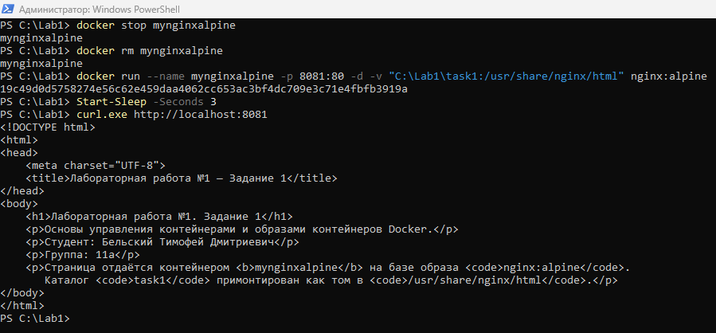

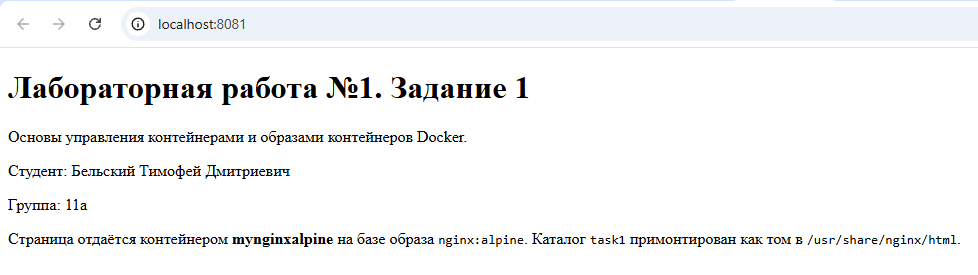

Правка HTML на хосте (строка «Изменено на лету, без пересборки образа») сразу видна в `curl` и браузере: nginx читает файл с диска при каждом запросе, слой образа не меняется.

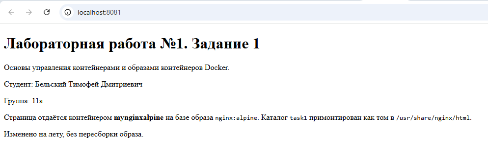

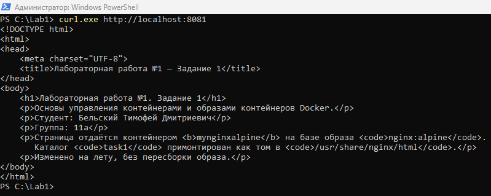

### Выводы по заданию 1

- Контейнер = процесс + изолированная ФС + сеть; образ неизменяем, контейнер имеет writable layer.
- Проброс портов обязателен для доступа с хоста; три контейнера на одном 80 внутри не конфликтуют, если хостовые порты разные.
- `exec` ≠ `attach`: exec — отдельная команда, attach — к stdin PID 1.
- Bind mount подходит для разработки статики; для «запекания» страницы в образ нужен `COPY` (задание 2).
- На Windows при монтировании надёжнее указывать абсолютный путь, а не `${PWD}`.

---

## Задание 2. Создание и публикация образа

### Что требовалось

Написать Dockerfile, собрать образ со своей HTML-страницей, запустить контейнер, изменить страницу и пересобрать, проанализировать слои, назначить теги и отправить образ в Docker Hub.

### Dockerfile

Файл `task2/Dockerfile`:

```dockerfile
FROM nginx:alpine
LABEL maintainer="Бельский Тимофей Дмитриевич <pipa53@example.com>"
LABEL description="Lab 1, Task 2 — nginx с собственной HTML-страницей"
COPY html/index.html /usr/share/nginx/html/index.html
EXPOSE 80
```

Отличие от задания 1: страница становится слоем образа. Контейнер самодостаточен, том не нужен. `EXPOSE 80` документирует порт; публикация по-прежнему через `-p`. `CMD` наследуется от `nginx:alpine` (`nginx -g daemon off;`).

Контекст сборки — каталог `task2/` (Dockerfile + `html/index.html`), без лишних файлов.

### Сборка и первый запуск

```powershell
cd C:\Lab1\task2
docker build -t mynginx-lab1:v1 .
docker image ls mynginx-lab1
docker run --name mynginx-lab1 -p 8083:80 -d mynginx-lab1:v1
curl.exe http://localhost:8083
```

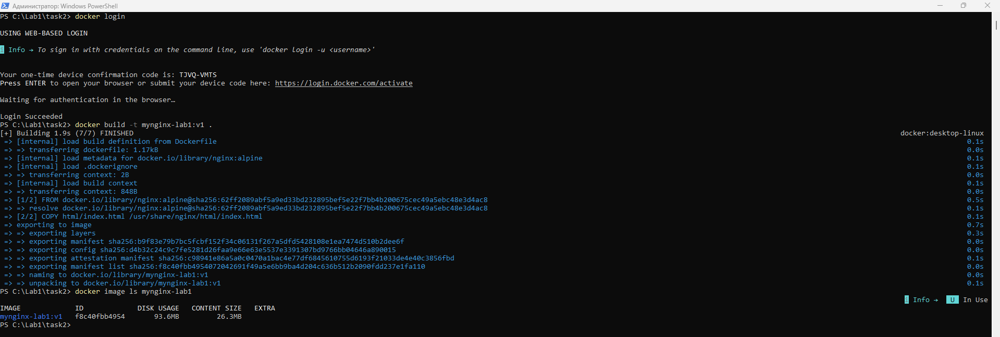

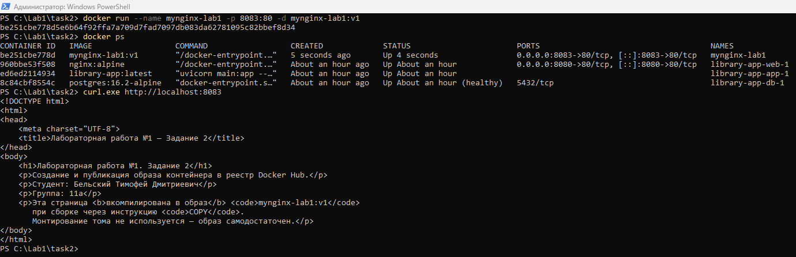

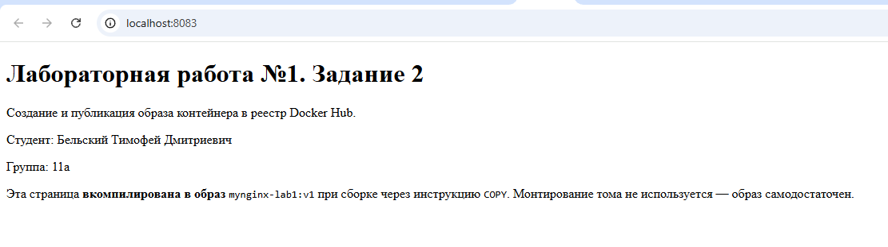

После правки `html/index.html` образ **не** обновляется сам: содержимое уже в слое. Нужны stop/rm контейнера и `docker build` заново (кеш `FROM` живёт, слой `COPY` пересобирается, потому что checksum файла изменился).

```powershell
docker stop mynginx-lab1; docker rm mynginx-lab1
docker build -t mynginx-lab1:v1 .
docker run --name mynginx-lab1 -p 8083:80 -d mynginx-lab1:v1
curl.exe http://localhost:8083
```

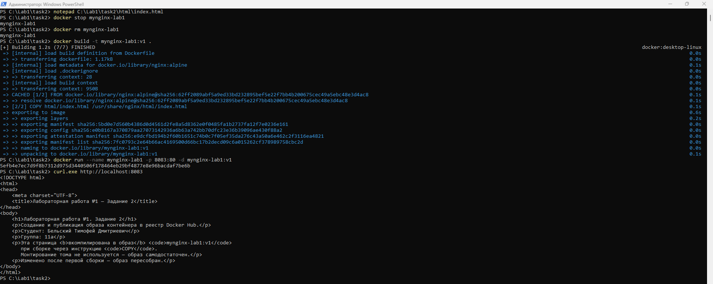

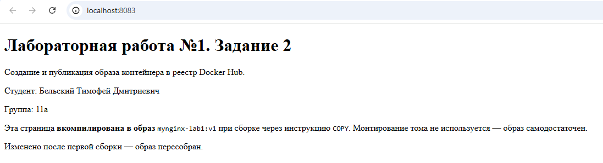

### Анализ слоёв

```powershell
docker image history mynginx-lab1:v1
docker image inspect mynginx-lab1:v1
```

`history` показывает цепочку: слои alpine/nginx + LABEL + COPY. Слои с размером 0 B — метаданные (ENV, CMD, EXPOSE) без файлов. `inspect` отдаёт JSON: `RootFS.Layers` (диффы overlayfs), `Config.Env`, `Config.Cmd`, `RepoTags`.

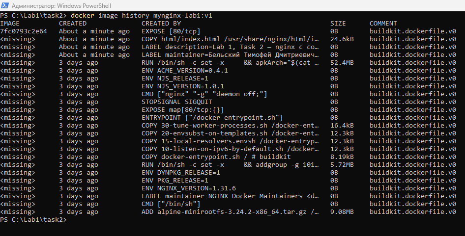

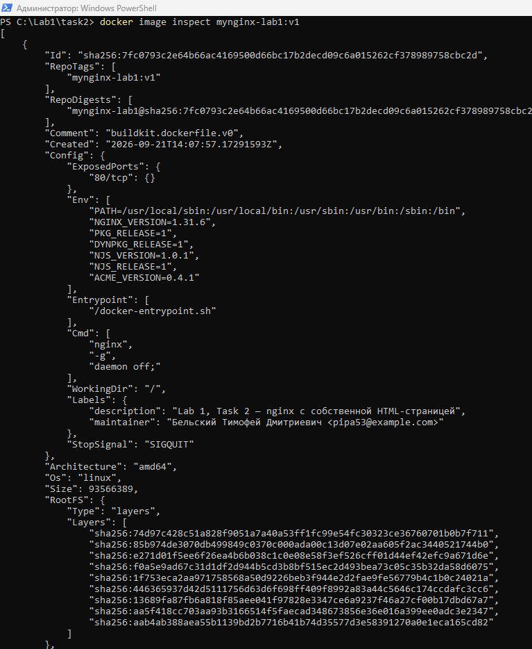

### Публикация в Docker Hub

Репозиторий: `https://hub.docker.com/r/timofeos/mynginx-lab1`, тег `v1`.

```powershell
docker login
docker tag mynginx-lab1:v1 timofeos/mynginx-lab1:v1
docker image ls
# два имени (локальное и Hub) указывают на один Image ID
docker push timofeos/mynginx-lab1:v1
```

`tag` не копирует слои, только добавляет имя в репозиторий образов. `push` загружает слои, которых ещё нет на Hub (базовый nginx:alpine часто уже есть у registry как foreign layer / совпадает по digest).

> При первом `docker login` в web-режиме потребовалось подтверждение через браузер; из-за сетевых ограничений использовался VPN.

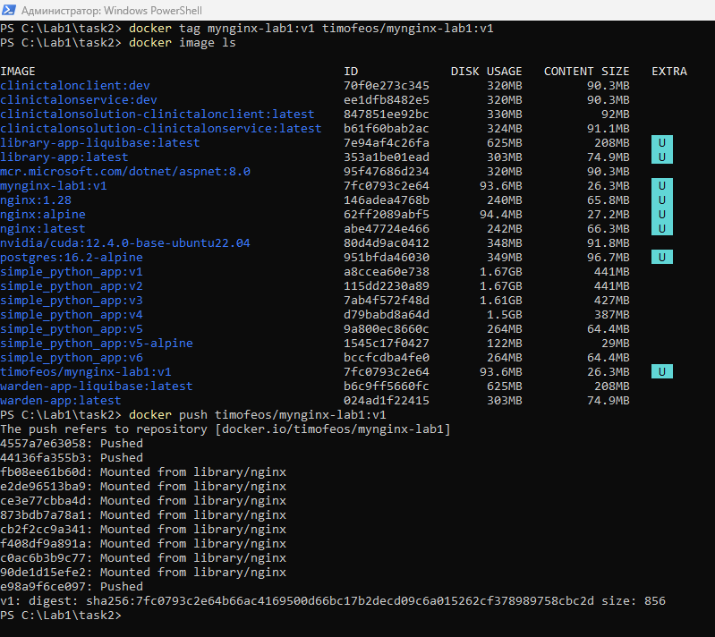

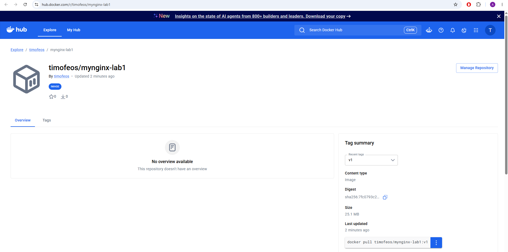

Best practice: тег `v1` фиксирует учебную версию; `latest` в работе не использовался как единственный идентификатор — для воспроизводимости лучше semver/дата.

### Выводы по заданию 2

- Dockerfile минимален: FROM + COPY достаточно для статического сайта на nginx.
- Изменение файлов на хосте не меняет уже собранный образ — нужна пересборка слоя COPY.
- `history`/`inspect` — основной способ понять, из чего состоит образ и почему он такого размера.
- Публикация: login → tag под `user/repo:tag` → push. Локальный и remote-теги могут сосуществовать на одном ID.

---

## Задание 3. Dockerfile и оптимизация образа

### Что требовалось

Пример 1: FastAPI + PostgreSQL локально. Пример 2: последовательность Dockerfile v1…v6 с уменьшением размера и non-root.

### Пример 1. Локальное приложение

Каталог `task3/simple_python_app/`: `app.py`, `requirements.txt` (`fastapi==0.110.2`, `uvicorn[standard]==0.29.0`, `psycopg2==2.9.9`).

PostgreSQL поднимался отдельным контейнером Docker (`postgres:16.2-alpine`, БД `api`, пользователь `apiuser`, порт `5432:5432`). На хосте создан venv.

> При локальной установке на Windows используется Python **3.13**: под 3.13 у `psycopg2-binary==2.9.9` нет готовых колёс, поэтому в `requirements.dev.txt` версия поднята до **`psycopg2-binary==2.9.12`**. В Docker-образах (Python 3.12.1) `psycopg2==2.9.9` собирается из исходников на стадии builder — там есть `gcc` и `libpq-dev`.

Установка зависимостей в venv прошла успешно:

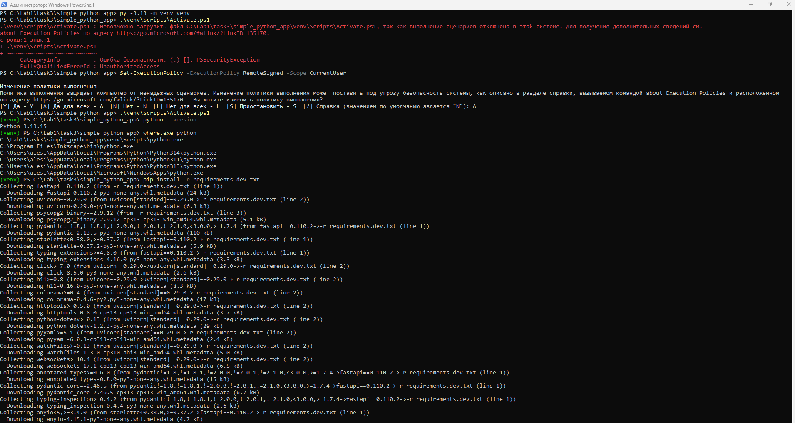

```powershell
uvicorn app:app --host 0.0.0.0 --port 8000
```

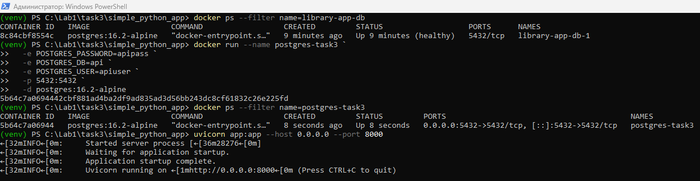

```powershell
curl.exe http://localhost:8000/
curl.exe http://localhost:8000/hello/Test
```

`GET /` выполняет `SELECT version();` и возвращает JSON с версией PostgreSQL. `GET /hello/{name}` — шаблон приветствия.

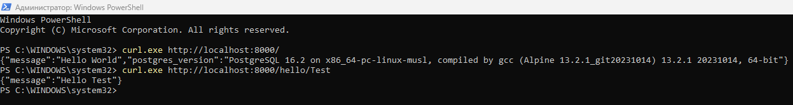

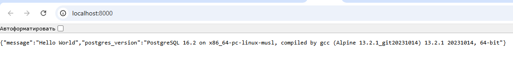

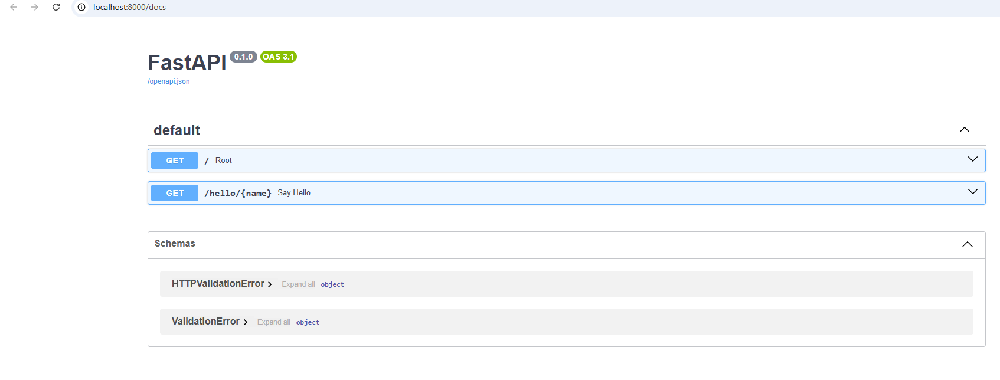

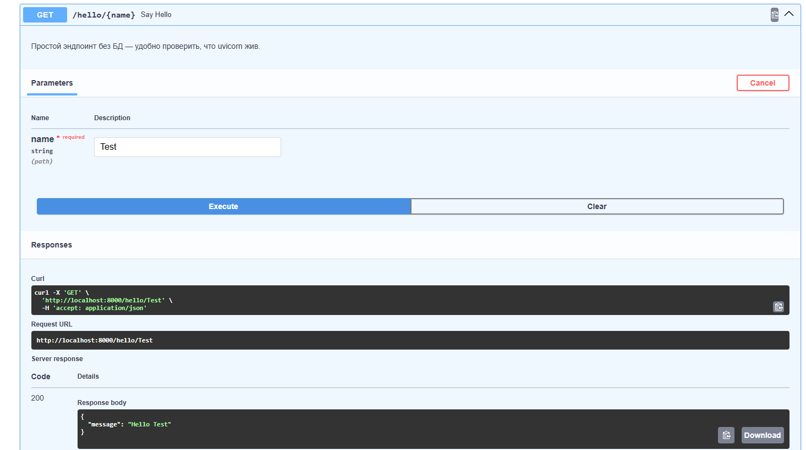

### Пример 2. Эволюция Dockerfile

Контекст v1 включал весь каталог (в т.ч. venv) — **38.15 MB**. Дальше контекст сужался за счёт копирования только `app.py` и bind-mount `requirements.txt`.

| Версия | Файл | Ключевой приём | Размер (docker image ls) |
| --- | --- | --- | --- |
| v1 | `Dockerfile.v1` | `COPY .` до pip, полный `python:3.12.1`, без очистки кеша | **441 MB** |
| v2 | `Dockerfile.v2` | порядок слоёв: apt → requirements → pip → код | 441 MB |
| v3 | `Dockerfile.v3` | `--mount=type=bind` + `COPY app.py` | **427 MB** |
| v4 | `Dockerfile.v4` | `--no-install-recommends`, `rm apt lists`, `pip --no-cache-dir --no-deps` | **387 MB** |
| v5 | `Dockerfile.v5-slim` | multi-stage, финал `python:3.12.1-slim` | **64.4 MB** |
| v5-alpine | `Dockerfile.alpine` | multi-stage Alpine + `apk` | **29 MB** |
| v6 | `Dockerfile.v6` / `Dockerfile` | slim + `USER app` (non-root) | ~64 MB, User=`app` |

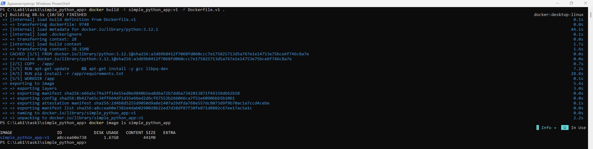

```powershell
docker run --name simple-app-v1 -e API_DB_HOST=host.docker.internal -p 8001:8000 -d simple_python_app:v1
curl.exe http://localhost:8001/
curl.exe http://localhost:8001/hello/Бельский
```

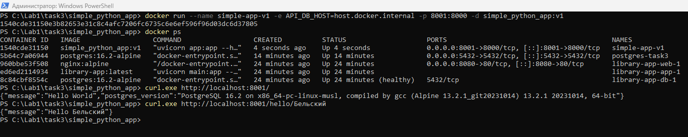

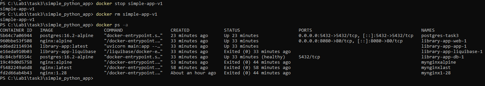

**v2.** `COPY requirements.txt` отдельным слоем: правка `app.py` не сбрасывает кеш `pip install`. Размер тот же — в образ по-прежнему попадает полный CPython и кеши.

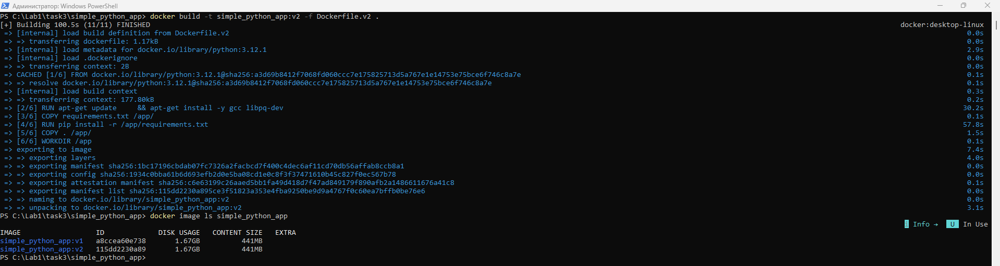

**v3.** BuildKit `RUN --mount=type=bind,source=requirements.txt,target=/app/requirements.txt` монтирует файл только на время RUN. `COPY app.py` не тащит venv из контекста.

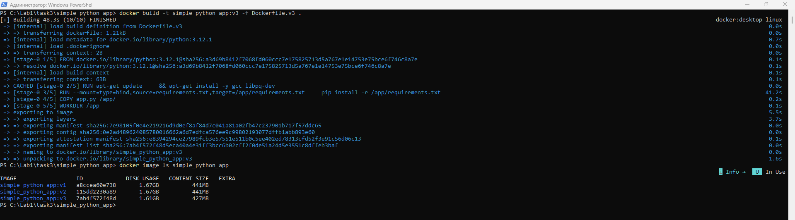

**v4.** Удаление `/var/lib/apt/lists/*` и отказ от pip-кэша уменьшают слой. `--no-deps` ставит ровно то, что в freeze-файле.

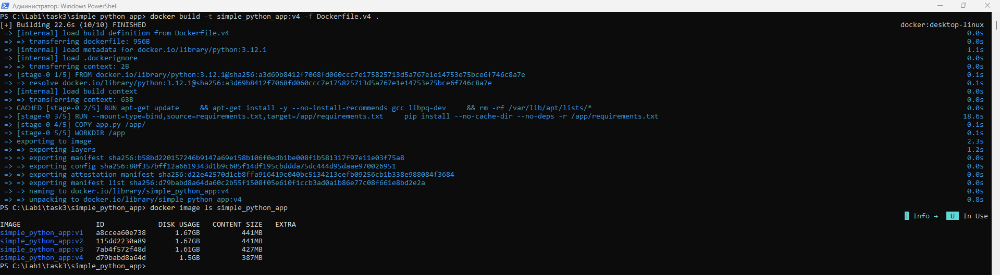

**v5 slim.** Стадия `builder` (gcc, libpq-dev, `pip wheel`) отбрасывается. Финал — slim + runtime `libpq-dev`/`libpq` + установка из `/wheels`.

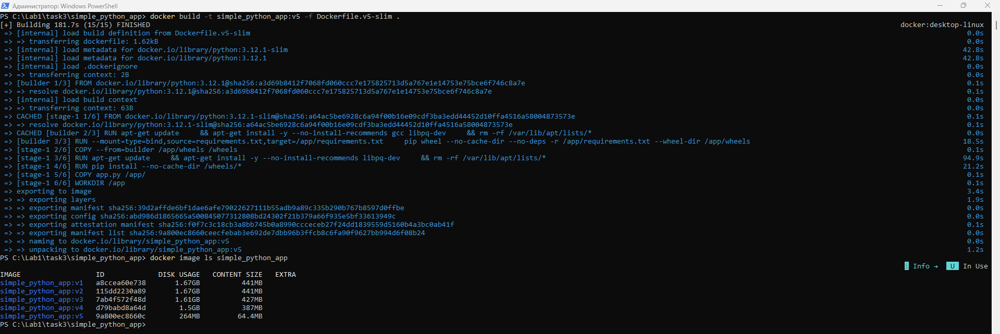

**v5 alpine.** `apk add gcc musl-dev postgresql-dev` в builder, в финале `libpq`. Минус: musl vs glibc, иногда ломаются колёса с нативными расширениями. Здесь psycopg2 собрался, размер **29 MB**.

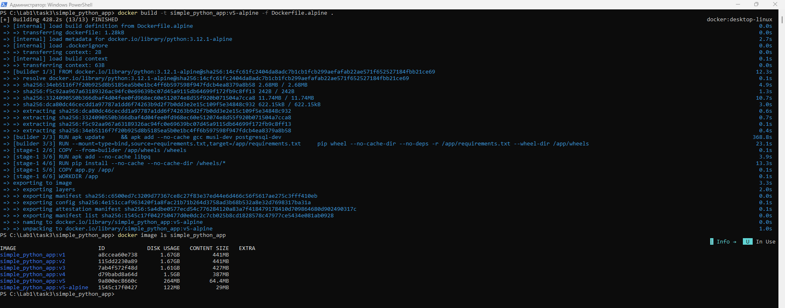

**v6.** Как slim, плюс:

```dockerfile
RUN addgroup --system app \
    && adduser --system --group app \
    && chown -R app:app /app/
USER app
```

`docker inspect` → `Config.User`: у v5 пусто/`root`, у v6 — `app`. Процесс uvicorn не имеет uid 0.

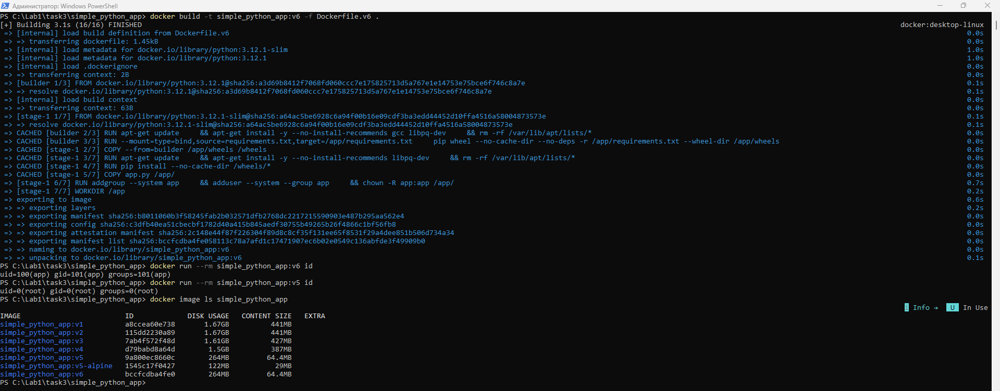

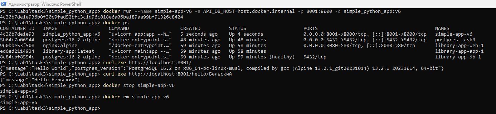

Рабочий файл без суффикса `Dockerfile` совпадает с v6 и используется дальше в задании 4.

### Техники (кратко)

1. Порядок инструкций: редко меняющееся — вверх.
2. Узкий контекст / `.dockerignore` (venv, `__pycache__`).
3. Bind-mount lock-файлов на время RUN (здесь — requirements).
4. Очистка apt/pip в **том же** `RUN`, иначе кеш остаётся в слое.
5. Multi-stage: компилятор не едет в прод.
6. Меньшая база (slim / alpine).
7. Non-root USER.
8. Не объединять «всё в один RUN» слепо: читаемость и кеш pip vs apt имеют разные частоты изменений.

### Выводы по заданию 3

С 441 MB до 29 MB — за счёт базы и отбрасывания toolchain, не за счёт «магии». v2 ускоряет *пересборку*, не уменьшая образ. Alpine дал минимум размера; для прод-стека выбран slim+non-root (v6): предсказуемый glibc и нормальный uid. Локально под Python 3.13 использован `psycopg2-binary==2.9.12` — потому что у 2.9.9 нет колёс под 3.13.

---

## Задание 4. Docker Compose

### Что требовалось

Описать три сервиса (web, app, db), сети, volume, зависимости с учётом готовности БД, собрать и поднять стек, снять логи, корректно остановить с удалением тома.

### Схема

```
хост :8080  -->  nginx:alpine (web)  -->  simple_python_app:8000
                                              |
                                              v
                                        postgres:16.2-alpine
                                        volume dbdata
```

Сети: `frontend-net` (web↔app), `backend-net` (app↔db). Nginx не в backend-net — до Postgres с фронта по overlay/bridge имени `db` не достучаться. Порт БД на хост не публикуется.

### compose.yaml (ключевые решения)

Файл: `C:\Lab1\task4\compose\compose.yaml`, имя проекта `simple-python-app`.

```yaml
web:
  image: nginx:alpine
  ports:
    - "8080:80"          # не 80:80 — порт 80 занят на Windows
simple_python_app:
  depends_on:
    db:
      condition: service_healthy
  restart: unless-stopped
db:
  healthcheck:
    test: ["CMD-SHELL", "pg_isready -U apiuser -d api"]
    interval: 10s
    timeout: 5s
    retries: 10
    start_period: 30s
    start_interval: 1s
```

Политика `restart: unless-stopped` у сервиса `simple_python_app`: контейнер перезапускается после падения и после reboot Docker, но не после явного `docker stop` / `compose stop`. У `web` политика по умолчанию (`no`) — Nginx в учебном стенде перезапускать вручную не требуется.

Healthcheck **обязан** указывать `-U apiuser -d api`. Дефолтный `pg_isready` идёт от unix-пользователя `root` внутри контейнера → в логах появилось бы `FATAL: role "root" does not exist`. Явное указание пользователя и БД сразу даёт чистые логи.

Переменные приложения: `API_DB_HOST=db` — DNS-имя сервиса Compose, не `localhost`.

Конфиг Nginx `nginx/app.conf`: `proxy_pass http://simple_python_app:8000;` — имя **сервиса**, Docker встраивает DNS в user-defined bridge.

### Команды проверки

```powershell
cd C:\Lab1\task4\compose
docker compose config
docker compose build
docker image ls
docker compose up -d
docker compose ps
curl.exe http://localhost:8080/
```

`config` интерполирует YAML и ловит синтаксические ошибки до запуска. `up -d` создаёт сети, volume и контейнеры; в логе виден счётчик 6/6 (2 сети, 1 volume, db, app, web).

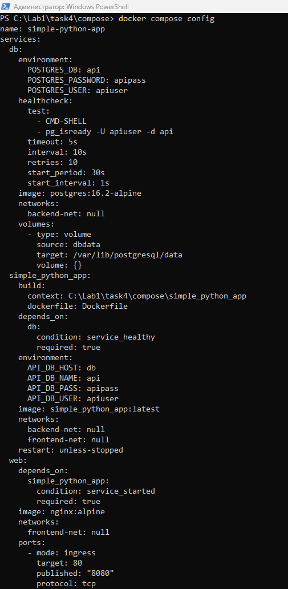

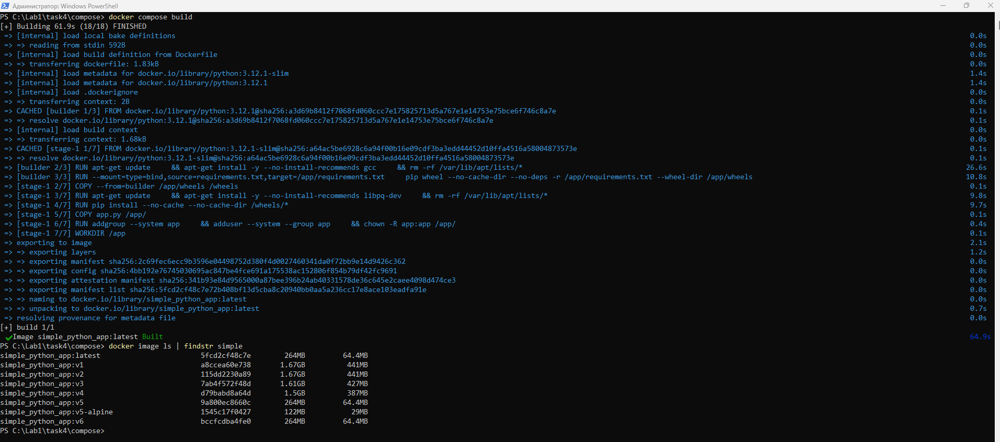

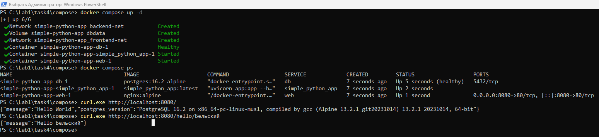

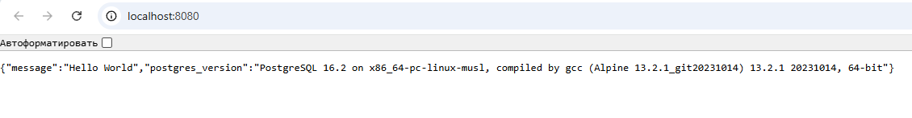

Ответ JSON: `Hello World` + строка `postgres_version` — запрос прошёл цепочку Nginx → uvicorn → libpq → Postgres.

### Логи

```powershell
docker compose logs db
docker compose logs simple_python_app
docker compose logs web
```

Логи db чистые: `database system is ready to accept connections` — благодаря healthcheck с явным `-U apiuser -d api` (при дефолтном `pg_isready` в логах шёл бы шум `FATAL: role "root" does not exist` каждые 10 секунд). Логи app — запуск uvicorn и access-строки `GET / HTTP/1.1" 200`. Логи web — access log Nginx.

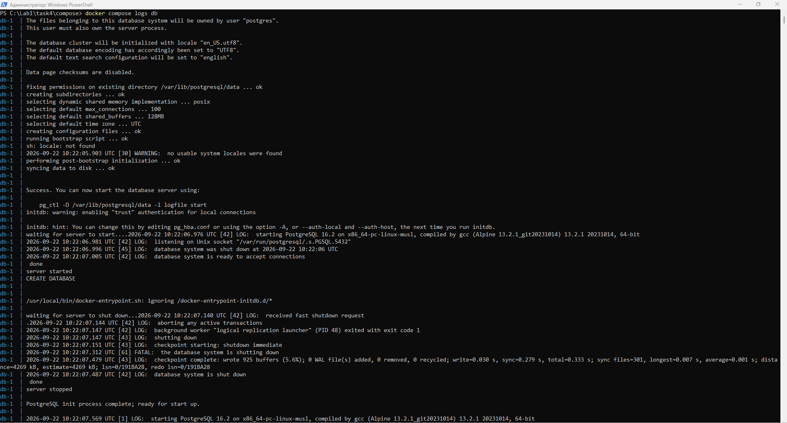

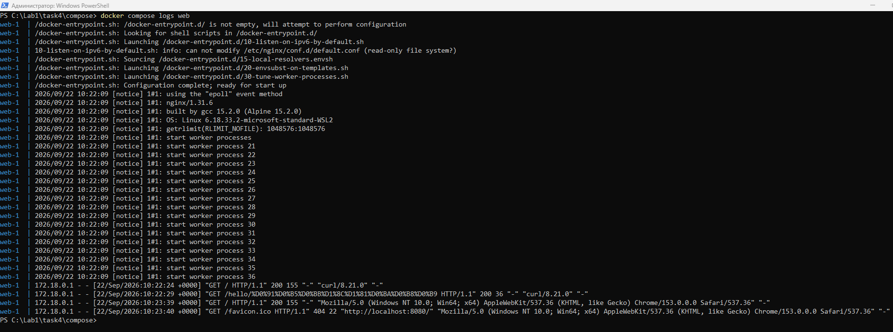

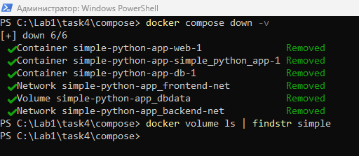

```powershell
docker compose down -v
docker volume ls
```

`-v` удаляет named volume `dbdata`. Без `-v` данные Postgres переживают пересоздание контейнера — это и нужно в разработке, пока не требуется «чистый» стенд.

### Dockerfile приложения в Compose

`C:\Lab1\task4\compose\simple_python_app\Dockerfile` — multi-stage slim, non-root `USER app`, `ENTRYPOINT ["uvicorn"]` + `CMD ["app:app", "--host", "0.0.0.0"]`. Переопределение CMD при `docker compose run` меняет аргументы uvicorn, бинарь остаётся.

### Выводы по заданию 4

- Compose описывает систему, а не один контейнер: сети режут поверхность атаки (БД не на хосте).
- `depends_on` без `condition` ждёт только start, не готовность; для Postgres нужен healthcheck с явными `-U/-d`.
- Порт 8080 вместо 80 — практическое ограничение Windows.
- `down -v` разрушает данные; для LLM-стека (задание 6) `-v` опасен из-за гигабайт весов Ollama.

---

## Задание 5. Развёртывание инфраструктуры проекта (вариант 1)

### Предметная область

Вариант 1 — **«Учёт читателей библиотеки»**. Сущность: читатель с ФИО, номером читательского билета и книгой на руках. Бизнес-правило:
- `has_ticket = true` — билет активен, читатель может брать книги;
- `book_title IS NOT NULL` — книга выдана на руки.

Возможности: **добавить** читателя, **изъять** читательский билет, **отредактировать** данные, **выдать книгу** на руки. Отчёт показывает: сколько всего читателей и сколько держат книгу на руках.

Физическое `DELETE` удаляет запись из БД; операции `revoke-ticket` и `issue-book` сохраняют историю в полях `has_ticket` / `book_title` / `book_issued_at`.

### Структура

```
C:\Lab1\task5\
├── compose.yaml
├── app/                 # FastAPI + SQLAlchemy + Pydantic
│   ├── main.py, crud.py, models.py, schemas.py, database.py
│   ├── Dockerfile, requirements.txt, .dockerignore
├── liquibase/
│   ├── Dockerfile, changelog.xml, liquibase.properties
│   └── changes/01-create-reader-table.sql
│       changes/02-insert-seed-data.sql
└── nginx/app.conf
```

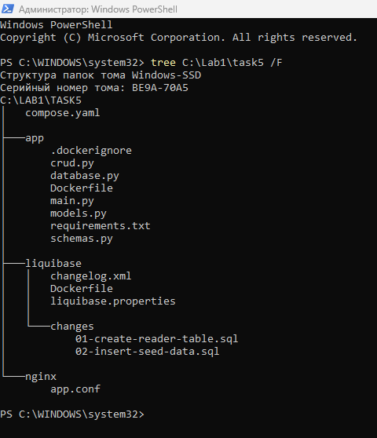

### Таблица `reader`

```sql
CREATE TABLE reader (
    id             SERIAL PRIMARY KEY,
    full_name      VARCHAR(255) NOT NULL,
    ticket_number  VARCHAR(50)  NOT NULL UNIQUE,
    has_ticket     BOOLEAN      NOT NULL DEFAULT TRUE,
    book_title     VARCHAR(255),
    book_issued_at DATE,
    created_at     TIMESTAMP    NOT NULL DEFAULT NOW()
);
```

Seed (changeset 2): Бельский, Иванов, Петрова, Сидоров, Кузнецова. У Бельского и Иванова заполнено `book_title` → в отчёте **5 / 2**.

### Миграции Liquibase

`changelog.xml` включает SQL-файлы по порядку. Формат `--liquibase formatted sql`, автор changeset `belsky`. Контейнер `liquibase` в Compose:

- `depends_on: db: condition: service_healthy`
- `command: --defaults-file=... update`
- `restart: "no"` — после успеха `Exited (0)`
- приложение: `depends_on: liquibase: condition: service_completed_successfully`

Таблицы служебные: `databasechangelog`, `databasechangeloglock`. Повторный `up` не дублирует INSERT — changeset уже в changelog (на втором запуске в логах было `Run: 0, Previously run: 2`).

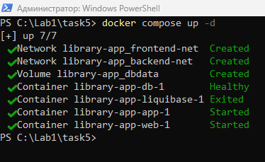

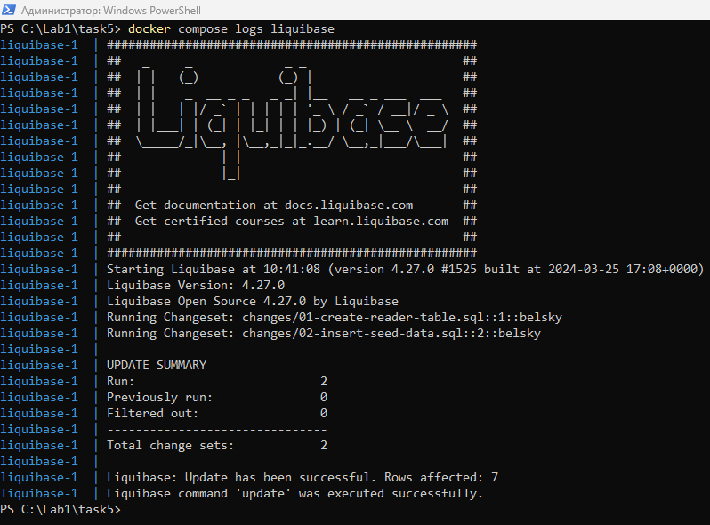

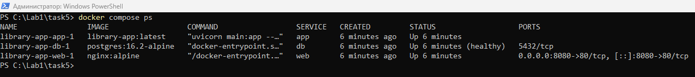

### FastAPI + SQLAlchemy + Pydantic

Слои:

| Модуль | Роль |
| --- | --- |
| `database.py` | `create_engine`, `SessionLocal`, dependency `get_db` |
| `models.py` | ORM `Reader`, `__tablename__ = "reader"` |
| `schemas.py` | `ReaderCreate` / `ReaderUpdate` / `ReaderOut` / `ReaderReport` / `BookIssue` |
| `crud.py` | `get_all, get_by_id, create, update, delete, revoke_ticket, issue_book, return_book, report` |
| `main.py` | HTTP-эндпоинты, коды 201/204/404/400, теги Swagger |

`ReaderUpdate` — все поля Optional, `model_dump(exclude_unset=True)` для частичного обновления. `ReaderOut` — `from_attributes=True`. Отчёт считается в Python по списку строк (учебный объём).

Эндпоинты:

| Метод | Путь | Назначение |
| --- | --- | --- |
| GET | `/` | служебная подсказка `/docs` |
| GET | `/readers` | список читателей |
| GET | `/readers/{id}` | карточка одного |
| POST | `/readers` | добавить читателя |
| PUT | `/readers/{id}` | частичное обновление |
| DELETE | `/readers/{id}` | жёсткое удаление |
| POST | `/readers/{id}/revoke-ticket` | изъять билет, повтор → 400 |
| POST | `/readers/{id}/issue-book` | выдать книгу (тело: `book_title`) |
| POST | `/readers/{id}/return-book` | вернуть книгу |
| GET | `/report` | `{total, with_books}` |

Nginx: `proxy_pass http://app:8000;` порт хоста **8080:80**.

### Проверки

```powershell
cd C:\Lab1\task5
docker compose up -d
docker compose logs liquibase
docker compose ps
curl.exe http://localhost:8080/readers
curl.exe http://localhost:8080/report
curl.exe http://localhost:8080/
```

Список читателей и отчёт:

```json
[{"id":1,"full_name":"Бельский Тимофей Дмитриевич","ticket_number":"AB-1001","has_ticket":true,"book_title":"Война и мир","book_issued_at":"2024-09-15",...}, ...]
{"total":5,"with_books":2}
```


### Полный CRUD-цикл

1. **POST `/readers`** — добавили Новикова (id=6). Отчёт: `{"total":6,"with_books":2}`.
2. **POST `/readers/6/issue-book`** — выдали «Мастер и Маргарита». Отчёт: `{"total":6,"with_books":3}`.
3. **POST `/readers/6/revoke-ticket`** — изъяли билет. Книга сброшена. Отчёт: `{"total":6,"with_books":2}`.
4. **DELETE `/readers/6`** — удалили запись. Отчёт вернулся к `{"total":5,"with_books":2}`.


Swagger `/docs`: группы System / CRUD / Operations.


> В Swagger кириллица отображается корректно (браузер с UTF-8), в отличие от вывода `curl` в PowerShell — это удобно для демонстрации.

```powershell
docker compose down -v
```


### Выводы по заданию 5

Схема живёт в Liquibase, не в `Base.metadata.create_all` — приложение стартует на уже мигрированной БД. Бизнес-логика выдачи книги и изъятия билета реализована как **отдельные операции** (`issue-book`, `revoke-ticket`), которые меняют состояние читателя, а не удаляют запись — так сохраняется история. Разделение frontend/backend сетей то же, что в задании 4. `DELETE` используется только для жёсткого удаления ошибочных записей. В задании 6 поверх этого стека появятся Redis-кэш `/report` и LLM-сервисы.

---

## Задание 6. Локальная LLM, dev/prod и Makefile

### 1. Что сделано

#### 1.1. LLM-инфраструктура

В `compose.yaml` (проект `library-llm`) к стеку «Учёт читателей библиотеки» добавлен локальный LLM-контур:

| Сервис | Порт на хосте | Роль |
| --- | --- | --- |
| `ollama` | `127.0.0.1:11434` | Инференс моделей, GPU NVIDIA |
| `litellm` | `127.0.0.1:4000` | OpenAI-совместимый роутер (`/v1/models`, `/v1/chat/completions`) |
| `openwebui` | `127.0.0.1:3000` | Чат в браузере через LiteLLM |
| `searxng` | `8085` | Веб-поиск для Open WebUI |
| `db` (PostgreSQL 16) | внутренний | БД `api` (приложение) и `litellm` (ключи/логи роутера) |
| `redis` | внутренний | кэш `GET /report` |
| `app` + `web` (Nginx) | `8080` | FastAPI за reverse-proxy |
| `liquibase` | — | одноразовые миграции, `Exited (0)` |


GPU проброшен в контейнер Ollama (`deploy.resources.reservations.devices`, драйвер `nvidia`). Проверка изнутри контейнера:

```
NVIDIA GeForce RTX 4070 Laptop, ~5.7 GB used / 8188 MiB total
```

Хостовая машина — ноутбук с **8 ГБ VRAM**. Это накладывает ограничение на размер контекста: `num_ctx=4096` — компромисс, при котором модель влезает в VRAM с частичным оффлоадом на CPU. При `num_ctx=16384` модель уходила на CPU больше чем наполовину и работала заметно медленнее.


Модели хранятся в volume `library-llm_ollama-data` (тома не удалять: десятки гигабайт весов).

Клиенты чата (Open WebUI, Aider) ходят в LiteLLM. Алиасы в `litellm/config.yaml`:

- `local`, `smart`, `fast` — `ollama_chat/mistral-nemo:12b`, `num_ctx=4096`

Провайдер именно `ollama_chat/` (не `ollama/`): так LiteLLM корректно отдаёт chat-completions. Из запросов выкидываются поля `thinking` / `thinking_budget` / `reasoning_effort` — иначе Ollama отвечает 400 на extended thinking из Claude Code v2.


Сети разделены: `frontend-net` (web↔app), `backend-net` (internal: app↔db↔redis), `llm-net` (internal: ollama↔litellm↔webui), `egress` (исходящий интернет).

#### 1.2. Claude Code CLI с локальной LLM

Claude Code поднимается **отдельным** compose: `docker-compose-claude.yml` (проект `claude-code`). Контейнер `claude-code` подключается к уже существующей сети `library-llm_llm-net` как external.

Подключение **напрямую к Ollama**, минуя LiteLLM:

```
ANTHROPIC_BASE_URL=http://ollama:11434
ANTHROPIC_API_KEY=ollama
ANTHROPIC_MODEL=claude-local
```

Ollama отдаёт нативный Anthropic Messages API (`/v1/messages`). Образ собирается из `claude/Dockerfile` (`node:22-slim` + `@anthropic-ai/claude-code`). Каталог `./app` монтируется в `/workspace`.

Кастомная модель `claude-local` создаётся из `claude/Modelfile`:

```
FROM mistral-nemo:12b
PARAMETER num_ctx 4096
PARAMETER temperature 0.1
```


Обёртка `claude/claude-wrapper.sh` подставляет `--tools Bash,Read,Glob,Grep,Edit,Write`, если список инструментов не задан явно.


#### 1.3. Dev/prod-окружения

Локальный стенд (`make up`) держит БД, Redis и Nginx **в Docker**. Для п.10 задания инфраструктура вынесена на хост.

`compose.dev.yaml` / `compose.prod.yaml` содержат **только** `app` и одноразовый `liquibase`. PostgreSQL, Redis и Nginx — системные службы хоста. Приложение ходит к ним через `host.docker.internal`.

| | Dev | Prod |
| --- | --- | --- |
| Исходники | bind-mount `./app:/app` | образ, без mount |
| Uvicorn | `--reload`, порт `127.0.0.1:8000` | без reload, тот же порт |
| Nginx на хосте | `deploy/nginx/dev.conf` (слушает 8080 → 8000) | `deploy/nginx/prod.conf` (слушает 80 → 8000) |
| Redis на хосте | `deploy/redis/redis.conf` | то же |

Конфигурации подготовлены и валидны (`docker compose -f compose.dev.yaml config` проходит без ошибок). Запуск требует системных служб на хосте (Postgres, Redis, Nginx), которых на тестовой машине нет — это подтверждает, что конфигурация действительно ожидает внешние сервисы, а не поднимает свои.

**`compose.dev.yaml`:**

```yaml
# =============================================================================
#  Dev: в контейнере только приложение (и одноразовый Liquibase).
#  PostgreSQL, Redis, Nginx — системные службы хоста.
# =============================================================================
name: library-dev

services:
  liquibase:
    build: ./liquibase
    extra_hosts:
      - "host.docker.internal:host-gateway"
    command:
      - --url=jdbc:postgresql://host.docker.internal:5432/${POSTGRES_DB}
      - --username=${POSTGRES_USER}
      - --password=${POSTGRES_PASSWORD}
      - --changeLogFile=changelog.xml
      - update
    restart: "no"

  app:
    build: ./app
    image: library-app:dev
    extra_hosts:
      - "host.docker.internal:host-gateway"
    environment:
      API_DB_HOST: host.docker.internal
      API_DB_PORT: "5432"
      API_DB_NAME: ${POSTGRES_DB}
      API_DB_USER: ${POSTGRES_USER}
      API_DB_PASS: ${POSTGRES_PASSWORD}
      API_REDIS_HOST: host.docker.internal
      API_REDIS_PORT: "6379"
    volumes:
      # Правки исходников подхватываются uvicorn --reload без пересборки образа.
      - ./app:/app
    ports:
      - "127.0.0.1:8000:8000"
    depends_on:
      liquibase:
        condition: service_completed_successfully
    command: ["main:app", "--host", "0.0.0.0", "--port", "8000", "--reload"]
    restart: unless-stopped
```

**`compose.prod.yaml`** — отличается от dev отсутствием bind-mount и `--reload`:

```yaml
# =============================================================================
#  Prod: в контейнере только приложение (и одноразовый Liquibase на деплое).
#  PostgreSQL, Redis, Nginx — системные службы хоста.
# =============================================================================
name: library-prod

services:
  liquibase:
    build: ./liquibase
    extra_hosts:
      - "host.docker.internal:host-gateway"
    command:
      - --url=jdbc:postgresql://host.docker.internal:5432/${POSTGRES_DB}
      - --username=${POSTGRES_USER}
      - --password=${POSTGRES_PASSWORD}
      - --changeLogFile=changelog.xml
      - update
    restart: "no"

  app:
    build: ./app
    image: library-app:prod
    extra_hosts:
      - "host.docker.internal:host-gateway"
    environment:
      API_DB_HOST: host.docker.internal
      API_DB_PORT: "5432"
      API_DB_NAME: ${POSTGRES_DB}
      API_DB_USER: ${POSTGRES_USER}
      API_DB_PASS: ${POSTGRES_PASSWORD}
      API_REDIS_HOST: host.docker.internal
      API_REDIS_PORT: "6379"
    ports:
      - "127.0.0.1:8000:8000"
    depends_on:
      liquibase:
        condition: service_completed_successfully
    restart: unless-stopped
```

#### 1.4. Makefile

Команды управления стендом (на Windows удобнее запускать из Git Bash; нужен GNU Make):

| Цель | Назначение |
| --- | --- |
| `make up` / `make down` | локальный стек; тома **не** удаляются |
| `make ps` / `make logs` | статус и логи |
| `make model-pull` | `ollama pull` (по умолчанию `mistral-nemo:12b`) |
| `make model-setup` | overlay `claude-local` из `claude/Modelfile` |
| `make claude-up` / `make claude` | контейнер CLI / интерактивная сессия |
| `make aider` | Aider через LiteLLM (`openai/local`) |
| `make dev-up` / `make prod-up` | только приложение на хостовых БД/Redis/Nginx |

Полный текст `Makefile`:

```makefile
# =============================================================================
#  Makefile — локальный LLM-стек (п.9) и dev/prod (п.10).
#  Локально всё в Docker: make up
#  Dev/prod: Postgres, Redis, Nginx на хосте, в Docker только приложение:
#    make dev-up    /  make prod-up
#  На Windows удобнее запускать из Git Bash. Нужен GNU Make.
# =============================================================================

COMPOSE        := docker compose
COMPOSE_DEV    := docker compose -f compose.dev.yaml
COMPOSE_PROD   := docker compose -f compose.prod.yaml
COMPOSE_CLAUDE := docker compose -f docker-compose-claude.yml

.PHONY: help up down restart logs ps pull \
	model-pull model-setup \
	claude-up claude-down claude \
	aider \
	dev-up dev-down dev-logs \
	prod-up prod-down prod-logs \
	app-rebuild

help:
	@echo "=== локальное окружение (п.9, всё в Docker) ==="
	@echo "  make up            поднять library + ollama + litellm + webui + searxng + redis"
	@echo "  make down          остановить локальный стек (тома НЕ удаляются)"
	@echo "  make logs          логи локального стека"
	@echo "  make ps            статус контейнеров"
	@echo "  make pull          docker compose pull"
	@echo "  make model-pull    скачать базовую модель в Ollama"
	@echo "  make model-setup   создать overlay claude-local (num_ctx=4096)"
	@echo "  make claude-up     контейнер Claude Code CLI"
	@echo "  make claude        интерактивный Claude Code (нужен TTY)"
	@echo "  make aider         Aider: редактирование кода через LiteLLM"
	@echo ""
	@echo "=== dev / prod (п.10, в Docker только app) ==="
	@echo "  make dev-up        приложение с --reload, БД/Redis/Nginx на хосте"
	@echo "  make dev-down      остановить dev-контейнеры"
	@echo "  make prod-up       приложение без bind-mount"
	@echo "  make prod-down     остановить prod-контейнеры"
	@echo ""
	@echo "Open WebUI:  http://127.0.0.1:3000"
	@echo "API (local): http://127.0.0.1:8080"
	@echo "LiteLLM:     http://127.0.0.1:4000"
	@echo "SearXNG:     http://127.0.0.1:8085"

# ----- п.9: локальная инфраструктура -----
# down без -v: volume ollama-data (десятки ГБ моделей) не трогаем.

up:
	$(COMPOSE) up -d

down:
	$(COMPOSE) down
	$(COMPOSE_CLAUDE) down

restart: down up

logs:
	$(COMPOSE) logs -f --tail=100

ps:
	$(COMPOSE) ps -a
	$(COMPOSE_CLAUDE) ps -a

pull:
	$(COMPOSE) pull

# База для claude-local. Переопределение: make model-pull OLLAMA_MODEL=…
model-pull:
	docker exec ollama ollama pull $(or $(OLLAMA_MODEL),mistral-nemo:12b)

# Overlay не качает веса повторно — только параметры из claude/Modelfile.
model-setup: model-pull
	docker cp claude/Modelfile ollama:/tmp/Modelfile
	docker exec ollama ollama create claude-local -f /tmp/Modelfile

claude-up:
	$(COMPOSE_CLAUDE) up -d --build

claude-down:
	$(COMPOSE_CLAUDE) down

# Нужен TTY (Git Bash / Windows Terminal). Из Make в cmd.exe -it часто ломается.
claude: claude-up
	docker exec -it claude-code claude

# Профиль tools: aider не стартует вместе с make up.
aider:
	$(COMPOSE) --profile tools run --rm aider

app-rebuild:
	$(COMPOSE) up -d --build app

# ----- п.10: dev (системные postgres/redis/nginx) -----
dev-up:
	$(COMPOSE_DEV) up -d --build

dev-down:
	$(COMPOSE_DEV) down

dev-logs:
	$(COMPOSE_DEV) logs -f --tail=100

# ----- п.10: prod -----
prod-up:
	$(COMPOSE_PROD) up -d --build

prod-down:
	$(COMPOSE_PROD) down

prod-logs:
	$(COMPOSE_PROD) logs -f --tail=100
```

---

### 2. Проблема с tool-calling и её решение

Это центральная часть задания 6.

#### Симптом

Claude Code CLI рассчитан на модели Anthropic: они возвращают **структурированные** `tool_use` в Messages API. Локальные модели 7–12B часто **печатают** вызов инструмента как текст:

- JSON вроде `{"name": "Glob", "arguments": {"pattern": "**/*"}}`
- XML вроде `<TOOL_CALLS>...</TOOL_CALLS>`

CLI такой текст **не исполняет**. В ответе появляются выдуманные файлы, зависания или «псевдо-вызовы».

Отдельно мешал слишком большой каталог инструментов Claude Code (15+ штук: Task, MCP, Skill, агенты и т.д.). Модель 7–12B «тонет» в выборе и начинает вызывать несуществующие имена.

#### Что пробовали

Первая попытка — `qwen2.5-coder:7b` (4.7 ГБ, влезает в 8 ГБ с большим запасом). Модель отвечает на прямые вопросы, но **tool-calling не работает**: на запрос «Какие файлы в директории?» Claude Code получил от модели **текстовый JSON** вместо структурированного `tool_use`:


Переключились на `mistral-nemo:12b` (7.1 ГБ) — из опробованных 7–14B именно она отдаёт **структурированные** `tool_use`, которые Claude Code корректно исполняет как `Bash`/`Read`/`Grep`.


#### Что помогло (три изменения)

1. **Урезание списка инструментов** в `claude/claude-wrapper.sh`:

   ```bash
   claude --tools Bash,Read,Glob,Grep,Edit,Write
   ```

   Модель видит только 6 инструментов вместо 15+.

2. **Кастомный overlay `claude-local`** — `mistral-nemo:12b`, `num_ctx=4096`, `temperature=0.1`. Контекст 4096 выбран под 8 ГБ VRAM (при 16k модель уходит в CPU и работает медленнее).

3. **Прямой URL на Ollama** (`ANTHROPIC_BASE_URL=http://ollama:11434`), без LiteLLM. LiteLLM остаётся роутером для Open WebUI и Aider. Claude Code говорит с Ollama нативным Anthropic API — меньше преобразований формата.

#### Результат

После отката на mistral-nemo запрос «Какие файлы в директории?» отработал за **13 секунд**:

- ход 1: реальный вызов `Bash` (или `Glob`);
- ответ со **реальными** файлами `/workspace`: `.dockerignore`, `CLAUDE.md`, `Dockerfile`, `cache.py`, `crud.py`, `database.py`, `main.py`, `models.py`, `requirements.txt`, `schemas.py`.


Второй тест — `Read main.py`. Claude Code вызвал `Read`, прочитал файл и вернул корректное описание **всех девяти эндпоинтов** (`/readers`, `/readers/{id}`, POST, PUT, DELETE, `/revoke-ticket`, `/issue-book`, `/return-book`, `/report`, `/health`). Ответ за 32 секунды.


Третий тест — `Grep def report`. Claude Code вызвал `Grep`, нашёл функцию в `crud.py`, но при демонстрации тела **додумал** его (использовал `models.Reader` вместо `Reader`, `.count()` вместо `len()`). Это известное ограничение 12B модели — **инструмент вызывается корректно, но после Grep модель не читает файл целиком**. Для точного анализа надо явно просить `Read` файла, а не `Grep` функции.


Четвёртый тест — простой вопрос без инструментов («Сколько будет 2+2?»). Модель ответила без вызова инструментов, что подтверждает: Claude Code не дёргает инструменты зря.


**Ограничения выбранной модели (12B, 8 ГБ VRAM):**
- Модель частично уходит на CPU (`27% CPU / 73% GPU`) — inference медленнее в ~4 раза по сравнению с полностью GPU-загрузкой.
- После `Grep` модель иногда не читает файл, а «додумывает» тело функции.
- Контекст 4096 достаточен для коротких сессий, но не оставляет большого запаса для длинных диалогов.

Для промышленного применения нужны модели 30B+ или облачные API — вывод согласуется с сообществом.

---

### 3. Структура проекта

```
task6/
├── compose.yaml                 # local: app + db + redis + nginx + LLM-стек
├── compose.dev.yaml             # только app + liquibase, БД/Redis/Nginx на хосте
├── compose.prod.yaml            # то же без bind-mount и --reload
├── docker-compose-claude.yml    # Claude Code CLI → Ollama
├── Makefile                     # up/down/dev/prod/claude/aider
├── .env.example                 # шаблон переменных (секреты только в .env)
├── .gitignore
├── app/                         # FastAPI «Учёт читателей библиотеки»
│   ├── main.py                  # эндпоинты /readers, /report, /health, …
│   ├── crud.py                  # в т.ч. report(): total / with_books
│   ├── models.py, schemas.py, database.py, cache.py
│   ├── Dockerfile, requirements.txt, CLAUDE.md
├── liquibase/                   # changelog + seed из 5 читателей
├── nginx/app.conf               # proxy в local-стеке
├── deploy/nginx/{dev,prod}.conf # конфиги Nginx на хосте
├── deploy/redis/redis.conf
├── init-db/01-create-litellm-db.sql
├── litellm/config.yaml          # алиасы local / smart / fast
├── claude/
│   ├── Dockerfile
│   ├── Modelfile                # FROM mistral-nemo:12b, num_ctx 4096
│   ├── claude-wrapper.sh        # --tools Bash,Read,Glob,Grep,Edit,Write
│   └── settings.json
├── searxng/settings.yml
└── ide/continue-config.json     # Continue → LiteLLM (чат + autocomplete)
```

---

### 4. Проверки

Прогоны выполнены на текущем стенде. Здесь — фактические результаты CLI и `curl`.

#### 4.1. Контейнеры

`docker compose ps`: `db`, `redis`, `app`, `web`, `ollama`, `litellm`, `openwebui`, `searxng` — Up; `ollama`/`litellm`/`openwebui`/`db`/`redis` — healthy; `liquibase` — Exited (0).

`docker compose -f docker-compose-claude.yml ps`: `claude-code` — Up.

`docker exec ollama ollama list`: `claude-local:latest` (overlay 12.2B на базе mistral-nemo), `mistral-nemo:12b`.

`docker compose -f compose.dev.yaml ps`: пусто при работающем local-стеке; в YAML только `app` и `liquibase`.

#### 4.2. API читателей

```powershell
curl.exe -s http://localhost:8080/health
# {"db":"ok","redis":"ok"}

curl.exe -s http://localhost:8080/readers
# JSON, 5 записей (Бельский, Иванов, Петрова, Сидоров, Кузнецова)

curl.exe -s http://localhost:8080/report
# {"total":5,"with_books":2}
```


#### 4.3. LiteLLM

```powershell
$key = (Get-Content .env | Select-String "^LITELLM_MASTER_KEY=").ToString().Split("=",2)[1]
curl.exe -s http://localhost:4000/v1/models -H "Authorization: Bearer $key"
# {"data":[{"id":"local",...},{"id":"smart",...},{"id":"fast",...}]}
```

Ключ в отчёт не копируется.

#### 4.4. Claude Code (интерактивно)

Запросы в TUI Claude Code:

| Промпт | Результат |
| --- | --- |
| Какие файлы в директории? | ~13 с, реальный `Bash`/`Glob`, список файлов `/workspace` |
| Прочитай main.py и кратко опиши эндпоинты | ~32 с, реальный `Read`, описание всех 9 эндпоинтов |
| Найди функцию def report в файлах проекта | `Grep` → найдено в `crud.py`, но тело функции модель додумала |
| Сколько будет 2 + 2? | Простой ответ без вызова инструментов |

#### 4.5. Open WebUI

Браузерный чат работает на `http://localhost:3000`, направлен на LiteLLM (`OPENAI_API_BASE_URL=http://litellm:4000/v1`).


---

### 5. Команды управления

Git Bash / Make:

```bash
make up              # поднять library + ollama + litellm + webui + searxng + redis
make down            # остановить local + claude; тома сохранить
make ps
make logs
make model-setup     # pull базовой модели и создать claude-local
make claude-up
make claude          # TTY-сессия Claude Code
make aider
make dev-up / make dev-down
make prod-up / make prod-down
```

Эквиваленты Docker:

```bash
docker compose up -d
docker compose down
docker compose -f docker-compose-claude.yml up -d --build
docker exec -it claude-code claude
docker compose -f compose.dev.yaml up -d --build
docker compose -f compose.prod.yaml up -d --build
```

Не запускать `make down -v` / `docker compose down -v`: в `ollama-data` лежат модели.

---

### Приложение. Состояние после финальной проверки

- Инфраструктура local + Claude Code: работает.
- Tool-calling Claude Code: **mistral-nemo:12b** через overlay `claude-local`.
- API: `/health` = `{"db":"ok","redis":"ok"}`, 5 читателей, отчёт `{"total":5,"with_books":2}`.
- LiteLLM: модели `local`, `smart`, `fast`.
- Финальная очистка: `docker compose down` **без `-v`** — все три volume (`library-llm_dbdata`, `library-llm_ollama-data`, `library-llm_openwebui-data`) сохранены, модели не потеряны.


---

## Заключение

Выполнены все шесть заданий лабораторной работы №1: базовые операции Docker, публикация образа `timofeos/mynginx-lab1:v1`, оптимизация Python-образа 441→29 MB, Compose из трёх сервисов, CRUD «Учёт читателей библиотеки» с Liquibase, локальный LLM-контур с Claude Code CLI, Makefile и конфигурации dev/prod.

Технологии: Docker Engine 29.8.0, Compose v5.5.1, Nginx, FastAPI, PostgreSQL 16, Liquibase, Redis, Ollama, LiteLLM, Open WebUI, SearXNG, NVIDIA Container Toolkit.

Сложности: healthcheck Postgres от `root`; `psycopg2` без `pg_config` на Python 3.13; tool-calling локальных 7–12B моделей в Claude Code (рабочий вариант — `mistral-nemo:12b` напрямую в Ollama); ограничение 8 ГБ VRAM, из-за которого модель частично уходит на CPU; `host.docker.internal:5432` в dev без хостового Postgres.

Что улучшить: пул соединений вместо глобального cursor в заданиях 3–4; SQL-агрегаты для `/report`; секреты через Docker secrets/pass; не хранить пароли БД в YAML задания 4–5 открытым текстом на учебном стенде; для prod — оркестратор, а не один Compose на одной машине; для стабильного tool-calling — модель 30B+ или облачный API.

---

## Приложение А. Ответы на контрольные вопросы

### 1. Что такое Docker и зачем он нужен?

Docker — платформа контейнеризации: упаковка приложения вместе с runtime-зависимостями в образ и запуск изолированных процессов (контейнеров) на общем ядре хоста. В отличие от ВМ, нет гостевой ОС на каждый сервис — меньше накладных расходов и быстрее старт.

Преимущества для разработки: одинаковый стек у всех («у меня работает» исчезает), быстрый подъём Postgres/Redis/nginx без установки в Windows, воспроизводимые CI-сборки. Для эксплуатации: иммутабельные артефакты (тег образа), горизонтальное масштабирование одинаковых контейнеров, откат тегом, ограничение CPU/RAM, сети и volumes как декларация.

Альтернативы. **containerd** — runtime, который Docker Engine использует внутри; в Kubernetes часто containerd без Docker. **Podman** — бездемонная/rootless модель, CLI совместим с Docker, удобен в RHEL/ограниченных средах. **CRI-O** — runtime под Kubernetes. **LXC/LXD** — системные контейнеры ближе к лёгким ВМ. В этой работе выбран Docker Desktop 29.8.0: единый UX на Windows + WSL2, Compose v5, Buildx, NVIDIA runtime (`runtimes: nvidia runc` в `docker info`).

Сценарии: Podman — если политика запрещает демон root и нужен rootless systemd. containerd — когда оркестратор уже есть и Docker Engine лишний. Docker — разработка и одноузловой стенд, как в ЛР.

### 2. Что такое Docker-образ? Образ vs контейнер

Образ — неизменяемый слоёный снимок ФС + метаданные (CMD, ENV, ENTRYPOINT, User). Слои адресуются digest'ами; одинаковые слои шарятся между образами.

Получение: (1) `docker pull nginx:alpine` из registry; (2) `docker build` по Dockerfile — так собраны `mynginx-lab1:v1` и `simple_python_app:v6`; (3) `docker commit` работающего контейнера — антипаттерн, в работе не использовался.

Контейнер — экземпляр образа: writable layer сверху, свой PID/UTS/net namespace, точка монтирования volumes. Удаление контейнера (`docker rm`) не удаляет образ. Три nginx в задании 1 — три контейнера одного семейства образов; правка bind-mount не меняет образ, `COPY` в задании 2 — меняет слой образа при rebuild.

### 3. Как запустить контейнер, порты, имя, ресурсы

```powershell
docker run -d --name mynginxalpine -p 8081:80 nginx:alpine
docker run -d --name spa --cpus=1.0 --memory=256m -p 8000:8000 simple_python_app:v6
```

`-p 8080:80` — DNAT с хоста на контейнер. Формат `127.0.0.1:8080:80` публикует только localhost (так сделано для Ollama/LiteLLM/Open WebUI в задании 6). `--name` даёт DNS-имя в user-defined сети и удобный ключ для exec/logs. `--cpus` / `--memory` режут cgroup v2 (в `docker info` Cgroup Version: 2). В Compose лимиты задаются в `deploy.resources` (для Ollama — reservation GPU `driver: nvidia`).

Без `-d` процесс привязан к TTY: в задании 1 интерактивный nginx завершился в `Exited (0)`.

### 4. Логи контейнера

```powershell
docker logs mynginxlast
docker logs --tail 100 --since 10m web
docker compose logs -f db
docker logs --timestamps spa-v1 2>&1 | findstr /i "error"
```

Драйвер по умолчанию — `json-file` (`Logging Driver: json-file` в `docker info`). Фильтр по уровню приложение должно писать само (gunicorn/uvicorn в stderr); Docker не парсит syslog-priority из произвольного stdout.

Ротация:

```json
{
  "log-driver": "json-file",
  "log-opts": { "max-size": "10m", "max-file": "3" }
}
```

в `daemon.json` или в Compose `logging:`. Без ротации логи nginx/LiteLLM забьют диск. В задании 4 смотрели access-лог web и FATAL Postgres; в задании 6 — health LiteLLM.

### 5. Данные между перезапусками: volume, bind, tmpfs

Контейнерная writable layer живёт, пока жив контейнер; `docker rm` её уничтожает.

- **Named volume** (`dbdata:/var/lib/postgresql/data`, `ollama-data`) — управляется Docker, переживает `compose down`, удаляется `down -v`. Выбор для БД и весов моделей.
- **Bind mount** (`./task1:/usr/share/nginx/html`, `./nginx/app.conf:ro`, `./app:/app` в dev) — файлы с хоста, удобно для кода и конфигов. Права Windows/WSL иногда мешают Postgres data dir — поэтому данные БД не клали в bind.
- **tmpfs** — память, для секретов на время жизни контейнера или `/tmp` при `read_only: true`.

Кеш Redis в задании 6 — volume не обязателен (есть `--save 60 1` на диск внутри контейнера, но том не выделен: после down кэш `/report` пропадает — это приемлемо). Логи лучше не в bind на desktop без ротации.

### 6. Сети контейнеров

Типы: **bridge** (default и user-defined) — NAT + DNS имён на user-defined; **host** — сеть хоста, порты без `-p` (на Desktop/WSL ограниченно); **overlay** — Swarm/multi-host; **macvlan/ipvlan** — контейнер как хост в LAN; **null** — без сети.

В заданиях 4–6: user-defined bridge `frontend-net`, `backend-net` (`internal: true` в task6), `llm-net` (internal), `egress` для исходящего интернета. Internal не публикует порты «снаружи сети», но published ports на `frontend-net` нужны, поэтому frontend не internal.

Альтернатива «без сетей Docker»: все процессы на хосте (dev/prod задания 6 через `host.docker.internal`). Минус — нет изоляции и DNS сервисов.

### 7. Обращение по имени и DNS

На default bridge (`docker0`) встроенный DNS по имени контейнера исторически ненадёжен (ссылки `--link` устарели). На **user-defined** сети Engine встраивает DNS: имя сервиса Compose (`db`, `app`, `litellm`) резолвится в IP задач. Nginx пишет `proxy_pass http://app:8000`.

При перезапуске контейнера IP может смениться, **имя сервиса стабильно**. Если переименовать сервис в YAML, клиенты со старым hostname ломаются (нужно менять `API_DB_HOST`, `proxy_pass`). Scale-out (несколько реплик одного сервиса) даёт DNS round-robin — в ЛР реплик нет.

Claude Code подключается к существующей `library-llm_llm-net` как external и ходит на `http://ollama:11434`.

### 8. Метки (docker tag)

Тег — указатель `registry/user/repo:tag` на Image ID. `docker tag mynginx-lab1:v1 timofeos/mynginx-lab1:v1` создал второе имя на тот же ID (скрин task2-09).

Практики: конкретный тег (`v1`, git SHA, semver); `latest` плавает и не годится как единственный идентификатор продакшена. Не перезаписывать уже запушенный semver (иммутабельность). Удаление тега: `docker rmi user/repo:tag` снимает имя; если это последний тег и нет контейнеров — удаляется и образ. `docker rmi -f` по ID снимет все теги.

### 9. Удаление образов и контейнеров, очистка

```powershell
docker rm -f $(docker ps -aq)          # опасно на общей машине
docker container prune                 # только stopped
docker image prune / docker image prune -a
docker builder prune
docker system prune -a --volumes       # крайне опасно: сотрёт dbdata и ollama-data
```

Автоматизация: cron `docker image prune -f --filter until=168h`; в CI — `--rm` у run, Buildx `--cache-to`. Не удалять running: `prune` по умолчанию их не трогает; `-f` на `rm` работающего сначала kill. В задании 6 явно запрещён `down -v` из-за моделей.

### 10. Команда внутри контейнера: exec vs attach

`docker exec -it mynginxlast sh` — новый процесс, nginx не получает stdin. `docker attach` подключает к PID 1: Ctrl+C убьёт nginx, если он не игнорирует SIGINT. Для отладки API — exec (`curl` внутри claude-code к ollama, `ollama list` внутри ollama).

ENTRYPOINT/CMD задают PID 1 на старте (uvicorn, nginx). exec не заменяет entrypoint, а дополняет running-контейнер. Если нужно один раз выполнить миграцию — отдельный сервис `liquibase` с `restart: "no"`, а не exec руками (хотя `exec` годен для отладки).

### 11. Какие файлы меняет программа, diff слоёв

```powershell
docker diff mynginxalpine
docker image history mynginx-lab1:v1
docker buildx imagetools inspect timofeos/mynginx-lab1:v1
```

`diff` показывает A/C/D относительно образа: логи nginx в `/var/log`, pid-файлы. Сравнение слоёв образа: `history` (человекочитаемо) и `inspect .RootFS.Layers`. Dive (сторонний инструмент) визуализирует файлы слоя — в ЛР хватило history/inspect (скрины task2-06/07). Bind mount не виден как diff образа: изменения на хосте.

### 12. Завершение контейнера и graceful shutdown

Контейнер завершается, когда PID 1 выходит. `docker stop` → SIGTERM → `stop_timeout` (default 10s, в Compose `stop_grace_period`) → SIGKILL. Uvicorn/nginx обрабатывают SIGTERM: дозакрывают соединения. `docker kill` сразу SIGKILL — риск порчи WAL Postgres; для БД важен grace period.

`restart: unless-stopped` снова поднимет процесс после крэша, но не после stop. Liquibase должен завершиться сам (exit 0), иначе `service_completed_successfully` не наступит и app не стартует.

### 13. Кеш слоёв при сборке

Каждая инструкция — слой. BuildKit берёт кеш, если инструкция и checksum входов те же. В v1 `COPY .` стоял до pip: правка `app.py` или мусор в venv сбрасывал установку пакетов. v2 перенёс COPY кода вниз — пересборка секундная. `--mount=type=bind` не пишет requirements в слой, но участвует в ключе кеша RUN.

Multi-stage: изменение финального COPY app.py не пересобирает builder. `.dockerignore` уменьшает контекст (venv ~38 MB в v1). Измерение: `docker build --progress=plain` показывает `CACHED` vs running; `time docker build`.

### 14. Сколько слоёв и как мерить размер

Стремиться не к числу «магических 7», а к **осмысленным** слоям: не дробить `apt-get update` и `install` (иначе пустой index в слое и невоспроизводимость), не склеивать pip и копирование кода (разный TTL кеша). Очистка кеша пакетного менеджера в том же RUN.

Оценка: `docker image ls`, `docker history`, `docker builder du`. Таблица задания 3: 441 → 29 MB. Alpine выиграл за счёт базы, не за счёт «удаления слоёв».

### 15. Базовые инструкции Dockerfile

- **FROM** — база / стадия. Частая ошибка: `latest` без пина.
- **RUN** — слой с командой. Антипаттерн: `RUN apt-get update` отдельно от install.
- **COPY** — файлы из контекста. **ADD** — ещё URL и tar-автораспаковка (см. в.17).
- **WORKDIR** — cd + создание каталога.
- **ENV** — переменные runtime и последующих инструкций.
- **EXPOSE** — документация порта, не публикация.
- **CMD** / **ENTRYPOINT** — см. в.18.
- **USER** — non-root (v6).
- **LABEL** — метаданные (task2).

Документация: https://docs.docker.com/reference/dockerfile/. Линтер: [hadolint](https://github.com/hadolint/hadolint) (`DL3008` pin versions, `DL3042` pip cache). В ЛР версии Python/пакетов закреплены (`python:3.12.1`, `fastapi==0.110.2`).

### 16. Контекст сборки

Клиент шлёт tar контекста демону (или BuildKit). `COPY`/`ADD` видят только этот архив. Большой контекст (venv в task3 v1 = 38.15 MB) замедляет сборку даже при кеше. Оптимизация: собирать из узкого каталога (`task2/`), `.dockerignore` (`__pycache__`, `.git`, `venv`, `.env`). Секреты не должны попадать в контекст: `.env` в `.gitignore` и dockerignore.

### 17. COPY vs ADD

COPY — прозрачное копирование файлов. ADD дополнительно: скачивание по URL (сейчас лучше `RUN curl` + checksum) и распаковка локальных tar. В проекте везде COPY (`html/index.html`, `app.py`, колёса `--from=builder`). ADD не использовался — и не нужен.

### 18. CMD vs ENTRYPOINT

ENTRYPOINT — исполняемый файл (фиксированный). CMD — аргументы по умолчанию или полная команда, если ENTRYPOINT нет. Вместе: `ENTRYPOINT ["uvicorn"]` + `CMD ["main:app", "--host", "0.0.0.0"]` в task6. `docker run образ --reload` подменит CMD, не бинарь. Shell-форма `CMD uvicorn ...` запускает через `/bin/sh -c` и хуже обрабатывает сигналы (PID 1 = sh). Exec-форма JSON — правильная для graceful stop.

### 19. ARG vs ENV

ARG — только build-time (`docker build --build-arg`). После сборки ARG нет в runtime, если не скопировать в ENV. ENV попадает в `inspect Config.Env` и в процесс. Пароли через ARG опасны: они светятся в `history`, если не использовать secret mounts BuildKit. В Compose runtime-секреты — `environment` из `.env` (не коммитить).

### 20. Multi-stage builds

Несколько `FROM`. Артефакты копируются `COPY --from=builder`. Нужно, когда toolchain толще рантайма: `pip wheel` + gcc в задании 3; типичный Go `CGO_ENABLED=0` → `scratch`/`distroless`; React `npm run build` → nginx со `dist/`. Без multi-stage gcc и headers остаются в 441 MB-образе. v5/v6/alpine — учебный пример необходимости.

### 21. Компоненты Docker Engine

По `docker version`/`docker info` этой машины: **dockerd** (Engine 29.8.0), **containerd** v2.x, **runc** 1.4.3, **docker-init**, **Buildx**, CLI plugins (compose, scout, …). На Windows клиент общается с Linux-VM Desktop. Хранение: overlayfs через containerd snapshotter. Сеть: iptables. Опционально NVIDIA container runtime. Swarm inactive — оркестрация в ЛР только Compose.

### 22. Подробная информация о контейнере

```powershell
docker inspect mynginx-lab1
docker inspect -f "{{range.NetworkSettings.Networks}}{{.IPAddress}}{{end}}" web
docker inspect -f "{{json .Mounts}}" db
docker inspect -f "{{.Config.Env}}" app
docker inspect -f "{{.Config.User}}" simple-app-v6
```

IP, volumes, env, User, health, restart policy — всё в JSON inspect. Для Compose удобно `docker compose ps` + inspect по имени `project-service-1`.

### 23. Потребление ресурсов в реальном времени

```powershell
docker stats
docker stats ollama --no-stream
```

CPU %, Mem, Net I/O, Block I/O. Скрин задания 6: `docker stats` при простое ~0% CPU у всех; при инференсе VRAM смотрим `nvidia-smi` в контейнере и на хосте, `ollama ps` (100% GPU). Task Manager Windows дублирует загрузку GPU.

### 24. Docker Compose: возможности и docker-compose vs docker compose

Сервисы, volumes, networks, `depends_on`, build, env, profiles (`aider` в task6 — профиль `tools`), healthcheck, secrets (в Swarm/Compose spec), configs. Старый бинарь `docker-compose` (PyPI/v1) vs плагин `docker compose` (v2/v5): в Desktop установлен **v5.5.1**. Только у плагина: `docker compose watch`, bake-интеграция, `include`, развитый `depends_on.condition`, profiles, `docker compose alpha`/`bridge`. Команда в ЛР везде с пробелом: `docker compose up`.

### 25. Порядок запуска и готовность

`depends_on` list — порядок create/start, не readiness. Нужно:

```yaml
depends_on:
  db:
    condition: service_healthy
  liquibase:
    condition: service_completed_successfully
```

Healthcheck `pg_isready -U apiuser -d api`. Для LLM: litellm ждёт `db` healthy и `ollama` started; openwebui — litellm healthy. Без этого FastAPI в task4 ловил отказ соединения к Postgres на старте (глобальный `psycopg2.connect` в import-time).

### 26. Healthcheck

Инструкция Docker и поле Compose: периодическая команда, статусы starting/healthy/unhealthy. Restart-политики и depends_on опираются на статус. Примеры: `pg_isready`, `redis-cli ping`, `ollama list`, HTTP liveliness LiteLLM. Неправильный healthcheck хуже его отсутствия (шум FATAL role root). `start_period` / `start_interval` (task4 db) дают Postgres время на initdb.

### 27. Переопределение compose для dev/prod

Несколько файлов: `docker compose -f compose.yaml -f compose.override.yaml up`. В задании 6 отдельные проекты: `compose.yaml` (local полный стек), `compose.dev.yaml` / `compose.prod.yaml` (только app+liquibase), `docker-compose-claude.yml`. Dev: bind-mount исходников, uvicorn `--reload`, Nginx на хосте `:8080`. Prod-файл: образ без mount и без reload, Nginx хоста `:80`. Не держать local и dev одновременно — конфликт портов.

### 28. Почему не root и как non-root

Root в контейнере ≈ root на хосте при пробое изоляции/уязвимости ядра; запись в смонтированные тома от uid 0 портит права на хосте. v6: `adduser --system app`, `chown /app`, `USER app`. Проверка: `docker inspect` User и скрин task3-16/17 — API работает. Postgres официальный образ сам переключается на `postgres`. Нельзя drop root, если процесс слушает порт <1024 без capabilities — поэтому uvicorn на 8000, а 80 у nginx.

### 29. Read-only filesystem

```yaml
read_only: true
tmpfs:
  - /tmp
  - /var/run
```

Конфиг Nginx в task4/5/6 монтируется `:ro`. Приложение с read-only root нуждается в tmpfs для сокетов/pycache. Postgres data — только volume RW, не root FS. Полный read-only в ЛР не включали: uvicorn/LiteLLM пишут логи и pid; это следующий шаг hardening.

### 30. Секреты

Не коммитить `.env` (корневой `.gitignore`: `.env`, `**/.env`, исключение `!.env.example`). Не `docker build --build-arg PASSWORD`. Лучше: BuildKit `RUN --mount=type=secret`, Docker Compose `secrets:` (файлы в `/run/secrets`), Docker Desktop Pass plugin, внешние vault. В task6 ключи LiteLLM/Postgres подставляются `${LITELLM_MASTER_KEY}` из env_file, в отчёт не копируются. Пароли в YAML task4/5 (`apipass`) допустимы только как учебный стенд.

### 31. Ограничения Compose в Production

Один узел (или ручной overlay Swarm), нет зрелого rolling update/self-healing как у Kubernetes, слабее политики сети/RBAC, секреты проще утекают через env, нет стандартного HPA, service mesh, operators. Compose отличен для ноутбука и маленького VPS. Кластеры: Kubernetes (или Swarm) — расписание по нодам, реплики, probes, Ingress, autoscale. Задание 6 уже упирается в GPU одной машины и named volumes.

### 32. Docker Swarm vs Kubernetes

**Swarm** — встроенный оркестратор Docker: `docker swarm init`, сервисы, overlay, routing mesh, secrets. Проще операционно, слабее экосистема. На этой машине `Swarm: inactive`. **Kubernetes** — де-факто стандарт: Pod/Deployment/Service/Ingress, CRD, Helm, широкий runtime (containerd). Сложнее, зато портабельность между облаками. Для ЛР Swarm не поднимался: хватило Compose; переход «как в проде» — манифесты k8s или Nomad, не копирование `compose.yaml` as-is.

---

## Приложение Б. Список использованных источников

1. Docker Docs. Install, Dockerfile reference, Compose specification, networking, volumes, healthcheck. URL: https://docs.docker.com/
2. Docker Hub. Репозиторий `timofeos/mynginx-lab1`. URL: https://hub.docker.com/r/timofeos/mynginx-lab1
3. FastAPI documentation. URL: https://fastapi.tiangolo.com/
4. SQLAlchemy 2.0 documentation. URL: https://docs.sqlalchemy.org/
5. Pydantic v2 documentation. URL: https://docs.pydantic.dev/
6. Liquibase documentation (formatted SQL, changelog). URL: https://docs.liquibase.com/
7. PostgreSQL 16 documentation (`pg_isready`). URL: https://www.postgresql.org/docs/
8. Nginx reverse proxy. URL: https://nginx.org/en/docs/http/ngx_http_proxy_module.html
9. Ollama documentation. URL: https://docs.ollama.com/
10. LiteLLM documentation (OpenAI-compatible proxy). URL: https://docs.litellm.ai/
11. Open WebUI documentation. URL: https://docs.openwebui.com/
12. NVIDIA Container Toolkit. URL: https://docs.nvidia.com/datacenter/cloud-native/container-toolkit/
13. Методические указания по лабораторной работе №1 дисциплины «Непрерывное интегрирование и сборка программного обеспечения», БГУ, ФПМИ, кафедра технологий программирования, 2026.
14. Python Packaging: pip wheel / manylinux (обоснование multi-stage). URL: https://pip.pypa.io/
15. Kubernetes documentation (сравнение с Compose/Swarm, вопрос 31–32). URL: https://kubernetes.io/docs/
16. Podman documentation (вопрос 1). URL: https://docs.podman.io/